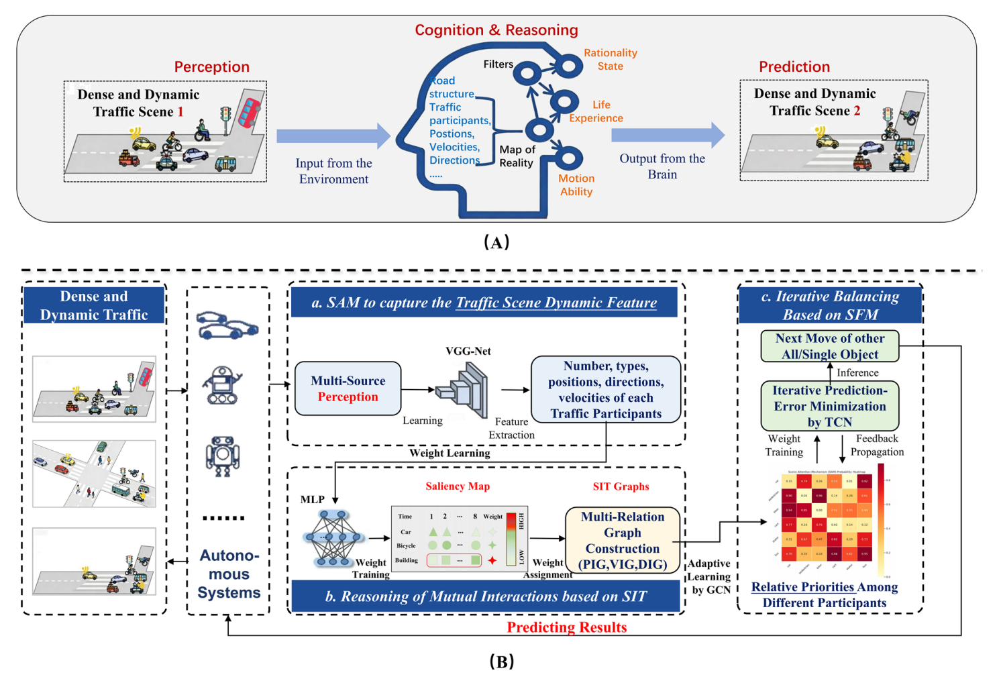
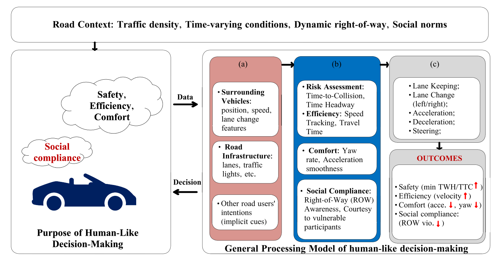
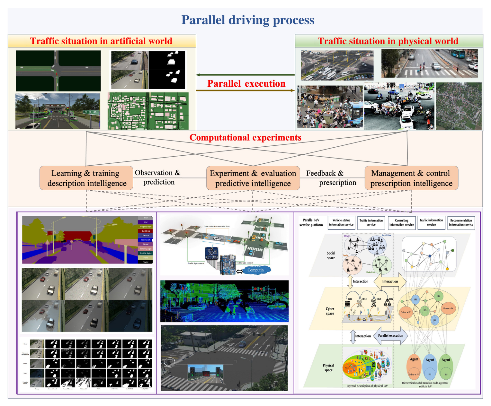
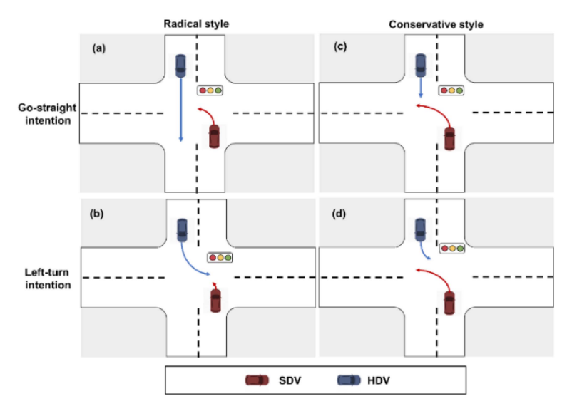
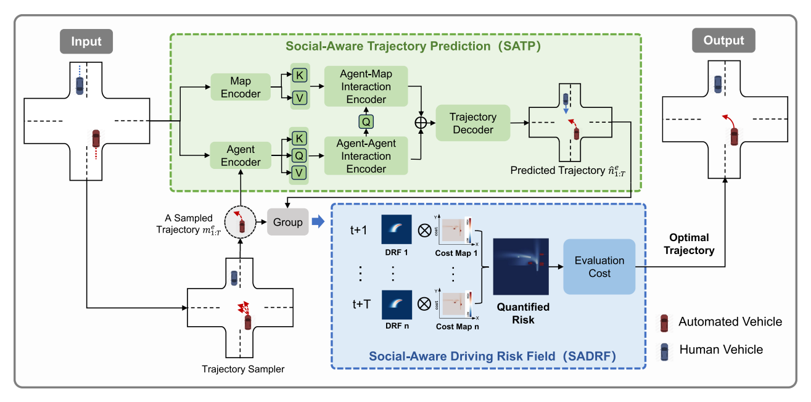
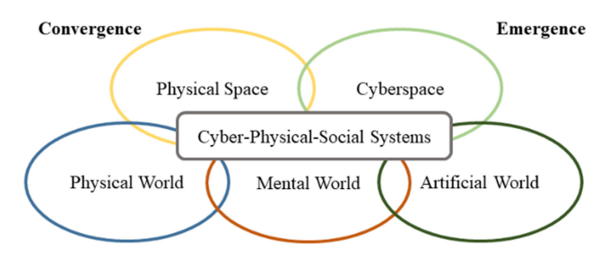
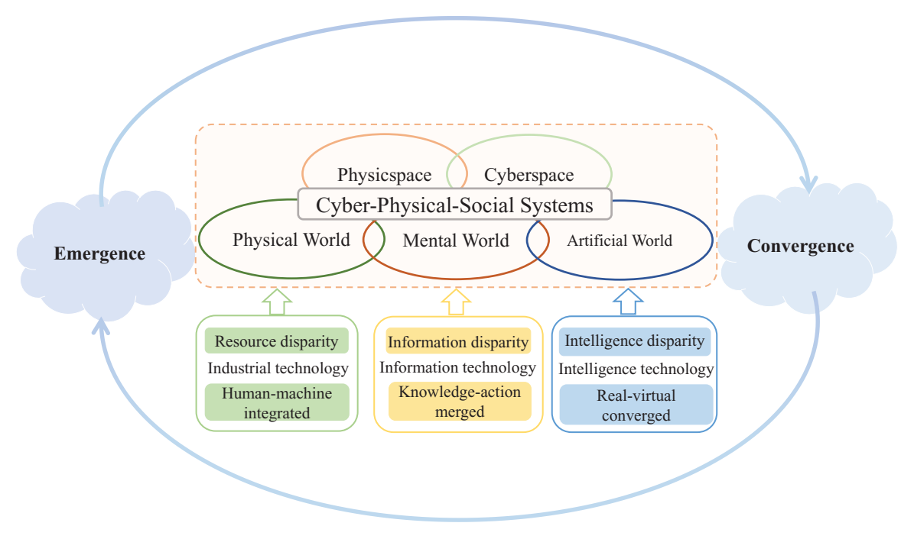
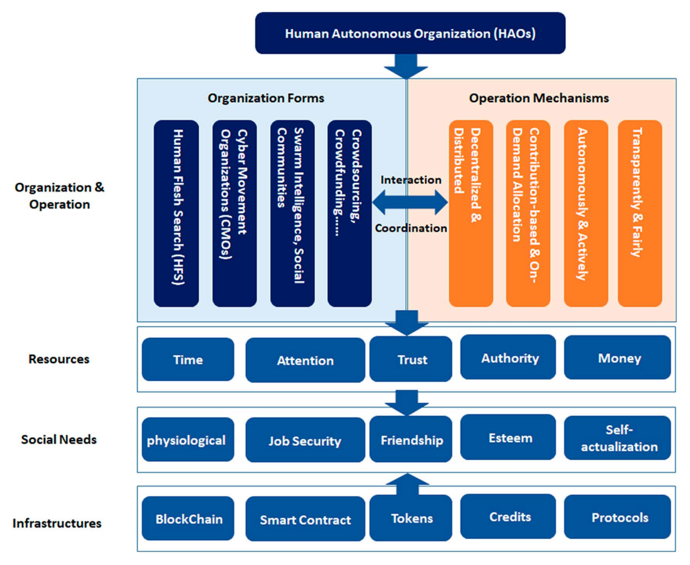
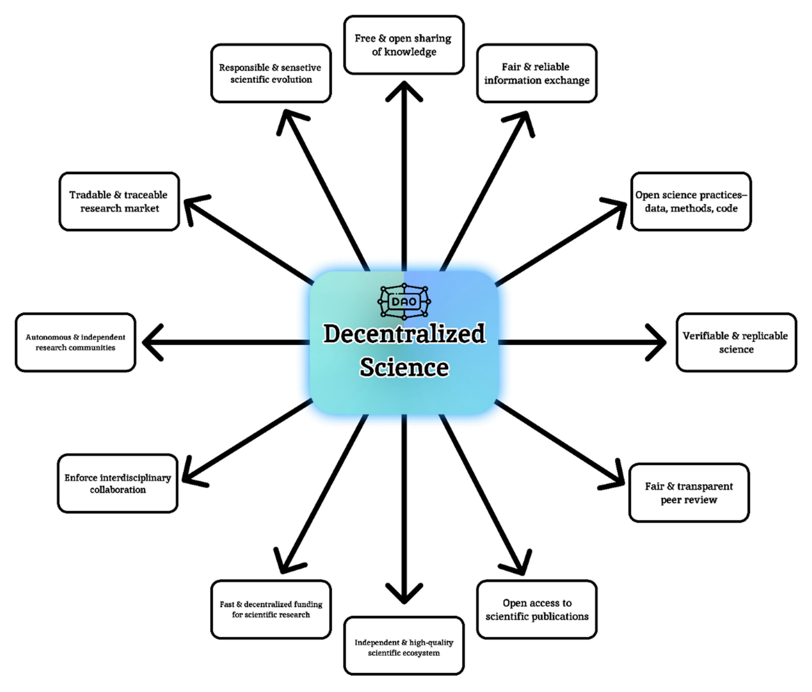

# Our Work on Fair and Just Artificial Intelligence

[← Project overview](README.md)

**Consequence-Aware Decision Making for Autonomous Robotics**

**9 publications · 5 venues**

Selected work spanning interpretable autonomy, safety-aware interaction, parallel intelligence, and responsibility-sensitive governance. The introductions below are editorial summaries, not copied abstracts. Open the publisher links for the original articles and their full evidence.

| Venue | Publications |
| :--- | ---: |
| [Nature Communications](#nature-communications) | 1 |
| [Proceedings of the IEEE](#proceedings-of-the-ieee) | 1 |
| [Research](#research) | 1 |
| [IEEE Transactions on Intelligent Vehicles](#ieee-transactions-on-intelligent-vehicles) | 2 |
| [IEEE Intelligent Systems](#ieee-intelligent-systems) | 4 |

## Nature Communications

**1 publication**

### 01. Embodied cognition-driven interpretable trajectory prediction of autonomous systems

**Nature Communications · 2026**  
Xiao Wang, Quancheng Du, Qiong Wu, Xiaofeng Jia, Liang Lin, Ljubo Vlacic, Changyin Sun, and Fei-Yue Wang  
17, Article 8363 (2026)

<table>
<tr>
<td width="38%" valign="top">

 Figure 2. Comparison of human cognition and the proposed interpretable prediction framework. Source: the linked article.
</td>
<td width="62%" valign="top">

<strong>Interpretable prediction · Embodied cognition · Social interaction</strong>

How can autonomous systems anticipate motion while making their reasoning understandable? This work connects scene attention, Social Impact Theory, and a physics-compliant Social Force Model in a hierarchical trajectory predictor. Evaluations on ETH and UCY, together with attention and interaction visualizations, examine how the model represents threats, intentions, and motion. The contribution centers on interpretable prediction; it does not by itself establish closed-loop driving safety.

<strong><a href="https://www.nature.com/articles/s41467-026-75091-9">Read the original article ↗</a></strong>

DOI: <a href="https://doi.org/10.1038/s41467-026-75091-9">10.1038/s41467-026-75091-9</a>

</td>
</tr>
</table>

## Proceedings of the IEEE

**1 publication**

### 02. Toward Safety-First Human-Like Decision Making for Autonomous Vehicles in Time-Varying Traffic Flow

**Proceedings of the IEEE · 2026**  
Xiao Wang, Junru Yu, Jun Huang, Qiong Wu, Ljubo Vlacic, and Changyin Sun  
114(4), pp. 609–627 (2026)

<table>
<tr>
<td width="38%" valign="top">

 Figure 1. Conceptual framework linking road context, human-like reasoning, actions, and their consequences. Source: the linked article.
</td>
<td width="62%" valign="top">

<strong>Safety-first decisions · Social compliance · Evolutionary reinforcement learning</strong>

This study addresses decisions in dense, changing traffic through a safety-first, human-like framework. Spatial-temporal attention supports intention inference, social compliance estimation regulates behavior, and deep evolutionary reinforcement learning expands policy search. CARLA experiments assess safety margins, efficiency, and comfort, linking decisions to their consequences for surrounding road users. The reported evidence comes from the evaluated simulation settings.

<strong><a href="https://ieeexplore.ieee.org/abstract/document/11520174">Read the original article ↗</a></strong>

DOI: <a href="https://doi.org/10.1109/JPROC.2026.3679470">10.1109/JPROC.2026.3679470</a>

</td>
</tr>
</table>

## Research

**1 publication**

### 03. Parallel Driving with Big Models and Foundation Intelligence in Cyber–Physical–Social Spaces

**Research · 2024**  
Xiao Wang, Jun Huang, Yonglin Tian, Chen Sun, Lie Yang, Shanhe Lou, Chen Lv, Changyin Sun, and Fei-Yue Wang  
7, Article 0349 (2024)

<table>
<tr>
<td width="38%" valign="top">

 Figure 1. ACP-based parallel driving: artificial systems, computational experiments, and parallel execution. Source: the linked article.
</td>
<td width="62%" valign="top">

<strong>Parallel driving · Foundation models · Cyber-physical-social systems</strong>

This article develops a parallel-driving perspective that brings foundation models, digital twins, and metaverse environments into cyber-physical-social spaces. Artificial systems, computational experiments, and parallel execution provide a setting for studying vehicle behavior and interactions before deployment. The work outlines an architecture, operating mechanisms, and research directions toward the 6S goals, rather than presenting a single universally validated driving policy.

<strong><a href="https://spj.science.org/doi/full/10.34133/research.0349">Read the original article ↗</a></strong>

DOI: <a href="https://doi.org/10.34133/research.0349">10.34133/research.0349</a>

</td>
</tr>
</table>

## IEEE Transactions on Intelligent Vehicles

**2 publications**

### 04. Safety-Balanced Driving-Style Aware Trajectory Planning in Intersection Scenarios With Uncertain Environment

**IEEE Transactions on Intelligent Vehicles · 2023**  
Xiao Wang, Ke Tang, Xingyuan Dai, Jintao Xu, Jinhao Xi, Rui Ai, Yuxiao Wang, Weihao Gu, and Changyin Sun  
8(4), pp. 2888–2898 (2023)

<table>
<tr>
<td width="38%" valign="top">

 Figure 1. Intersection examples illustrating how other drivers’ styles influence an autonomous vehicle’s planned trajectory. Source: the linked article.
</td>
<td width="62%" valign="top">

<strong>Driving styles · Multimodal planning · Intersection safety</strong>

Planning at intersections requires reasoning about drivers who may respond differently to the same situation. This two-stage method combines mixture-of-experts learning and Transformer-based interaction modeling to predict surrounding trajectories and generate candidate plans. A safety-balanced value function then selects among those plans. The study examines how driving-style awareness can support safer and more context-sensitive intersection behavior.

<strong><a href="https://ieeexplore.ieee.org/abstract/document/10026339">Read the original article ↗</a></strong>

DOI: <a href="https://doi.org/10.1109/TIV.2023.3239903">10.1109/TIV.2023.3239903</a>

</td>
</tr>
</table>

### 05. S⁴TP: Social-Suitable and Safety-Sensitive Trajectory Planning for Autonomous Vehicles

**IEEE Transactions on Intelligent Vehicles · 2024**  
Xiao Wang, Ke Tang, Xingyuan Dai, Jintao Xu, Quancheng Du, Rui Ai, Yuxiao Wang, and Weihao Gu  
9(2), pp. 3220–3231 (2024); first published online in 2023

<table>
<tr>
<td width="38%" valign="top">

 Figure 1. S⁴TP architecture coupling social-aware trajectory prediction with a social-aware driving risk field. Source: the linked article.
</td>
<td width="62%" valign="top">

<strong>Interactive prediction · Risk fields · Online trajectory optimization</strong>

S⁴TP couples social-aware trajectory prediction with a social-aware driving risk field. Predictions account for the autonomous vehicle’s planned motion, while risk maps describe interactions with surrounding human-driven vehicles. Online optimization uses these signals to seek lower-risk trajectories. Tests in SMARTS cover unprotected left turns, merging, cruising, and overtaking, with claims scoped to those evaluated scenarios.

<strong><a href="https://ieeexplore.ieee.org/stamp/stamp.jsp?tp=&amp;arnumber=10337798">Read the original article ↗</a></strong>

DOI: <a href="https://doi.org/10.1109/TIV.2023.3338483">10.1109/TIV.2023.3338483</a>

</td>
</tr>
</table>

## IEEE Intelligent Systems

**4 publications**

### 06. Metaverses and DeMetaverses: From Digital Twins in CPS to Parallel Intelligence in CPSS

**IEEE Intelligent Systems · 2022**  
Xiao Wang, Jing Yang, Jinpeng Han, Wei Wang, and Fei-Yue Wang  
37(4), pp. 97–102 (2022)

<table>
<tr>
<td width="38%" valign="top">

 Figure 1. The cyber-physical-social systems perspective connecting physical, mental, and artificial worlds. Source: the linked article.
</td>
<td width="62%" valign="top">

<strong>Digital twins · DeMetaverses · Human and organizational intelligence</strong>

This perspective revisits the move from cyber-physical systems to cyber-physical-social systems, emphasizing the inclusion of people and organizations. It contrasts digital twins with parallel intelligence and introduces DeMetaverses as DAO-based decentralized autonomous metaverses. The article provides a conceptual connection among virtual environments, social participation, and the 6S vision for smart societies.

<strong><a href="https://ieeexplore.ieee.org/abstract/document/9896794">Read the original article ↗</a></strong>

DOI: <a href="https://doi.org/10.1109/MIS.2022.3196592">10.1109/MIS.2022.3196592</a>

</td>
</tr>
</table>

### 07. Parallel Intelligence in CPSSs: Being, Becoming, and Believing

**IEEE Intelligent Systems · 2023**  
Jing Yang, Xiao Wang (Anhui University), Yonglin Tian, Xiao Wang (Purdue University), and Fei-Yue Wang  
38(6), pp. 75–80 (2023)

<table>
<tr>
<td width="38%" valign="top">

 Figure 1. The philosophy and structure of CPSSs, including emergence, convergence, and three forms of disparity. Source: the linked article.
</td>
<td width="62%" valign="top">

<strong>Parallel intelligence · ACP methodology · Human-machine collaboration</strong>

The article organizes parallel intelligence around three ideas: Being through artificial systems, Becoming through computational experiments, and Believing through parallel execution. It discusses CPSSs as settings in which human and machine intelligence interact, and examines the social implications of emerging AI. Its contribution is a methodological and conceptual framing for studying complex systems.

<strong><a href="https://ieeexplore.ieee.org/abstract/document/10352127">Read the original article ↗</a></strong>

DOI: <a href="https://doi.org/10.1109/MIS.2023.3284694">10.1109/MIS.2023.3284694</a>

</td>
</tr>
</table>

### 08. Smart Decentralized Autonomous Organizations and Operations for Smart Societies: Human–Autonomous Organizations for Industry 5.0 and Society 5.0

**IEEE Intelligent Systems · 2023**  
Xiao Wang, Yutong Wang, Mariana Netto, Larry Stapleton, Zhe Wan, and Fei-Yue Wang  
38(6), pp. 70–74 (2023)

<table>
<tr>
<td width="38%" valign="top">

 Figure 1. Human–autonomous organization framework linking social needs, resources, organization, and operations. Source: the linked article.
</td>
<td width="62%" valign="top">

<strong>Human values · Accountable governance · Industry 5.0</strong>

This article proposes human–autonomous organizations as a way to incorporate human intelligence, values, and needs into decentralized organizations and operations. The framework connects organizational mechanisms with resources and social needs, and discusses AI-generated content and prompt engineering for goal-guided activity. Fairness, transparency, and accountability are presented as design aims for smart-society governance.

<strong><a href="https://ieeexplore.ieee.org/abstract/document/10352174">Read the original article ↗</a></strong>

DOI: <a href="https://doi.org/10.1109/MIS.2023.3324471">10.1109/MIS.2023.3324471</a>

</td>
</tr>
</table>

### 09. The DAO to DeSci: AI for Free, Fair, and Responsibility Sensitive Sciences

**IEEE Intelligent Systems · 2022**  
Fei-Yue Wang, Wenwen Ding, Xiao Wang, Jon Garibaldi, Siyu Teng, Rudas Imre, and Cristina Olaverri-Monreal  
37(2), pp. 16–22 (2022)

<table>
<tr>
<td width="38%" valign="top">

 Figure 1. Characteristics and indicators of decentralized science, including participation, openness, and incentives. Source: the linked article.
</td>
<td width="62%" valign="top">

<strong>Decentralized science · Open participation · Responsibility-sensitive research</strong>

This perspective examines how decentralized autonomous organizations could change the organization and practice of science. It considers funding, participation, cross-disciplinary collaboration, and the implications for professional societies and publishing. The discussion introduces efforts toward free, fair, and responsibility-sensitive science, offering a governance agenda rather than an experimental demonstration of equitable outcomes.

<strong><a href="https://ieeexplore.ieee.org/abstract/document/9779591">Read the original article ↗</a></strong>

DOI: <a href="https://doi.org/10.1109/MIS.2022.3167070">10.1109/MIS.2022.3167070</a>

</td>
</tr>
</table>

---

### About this collection

The venue order follows the project’s chosen reading sequence. Within each venue, papers retain their order in the supplied list. Years follow the journal issue where available; S⁴TP appeared online in 2023 and in its journal issue in 2024.

Figures are selected previews from the corresponding publications and retain their original meaning. Original articles and complete results remain on the publishers’ websites. Figure rights remain with the respective rights holders; see [Figure credits](assets/README.md).
